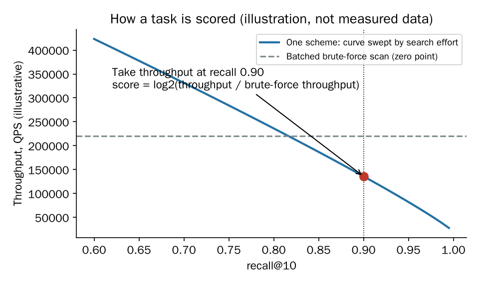
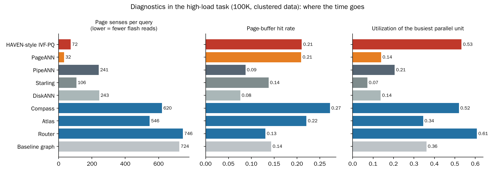
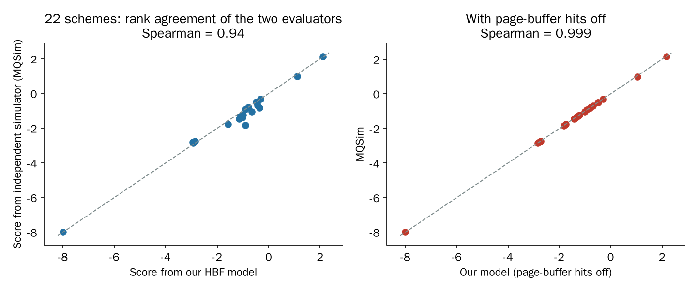
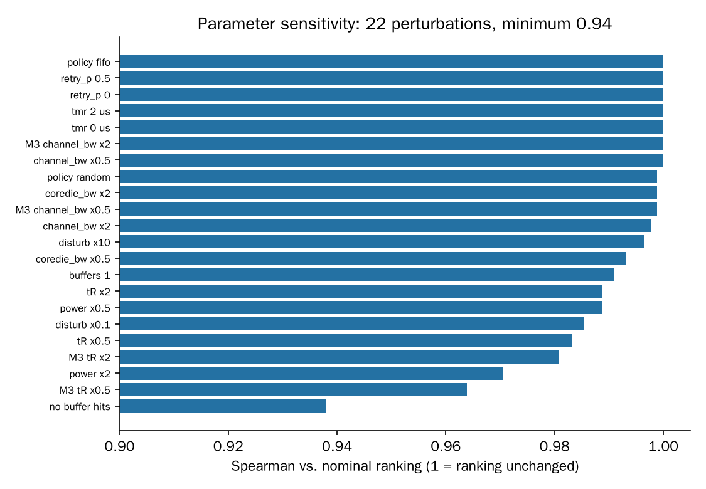
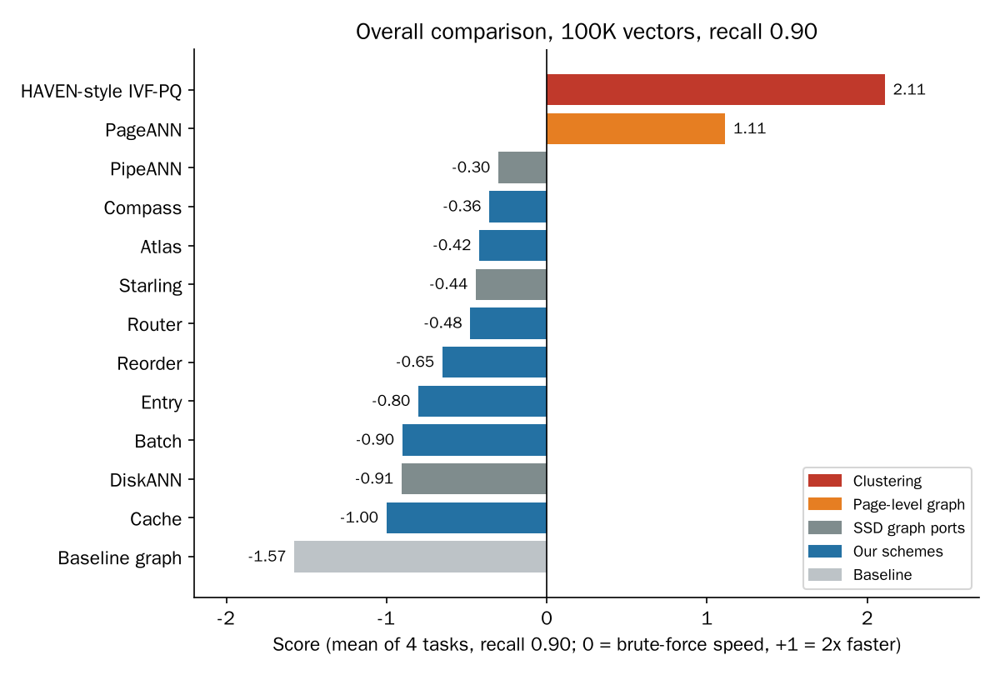
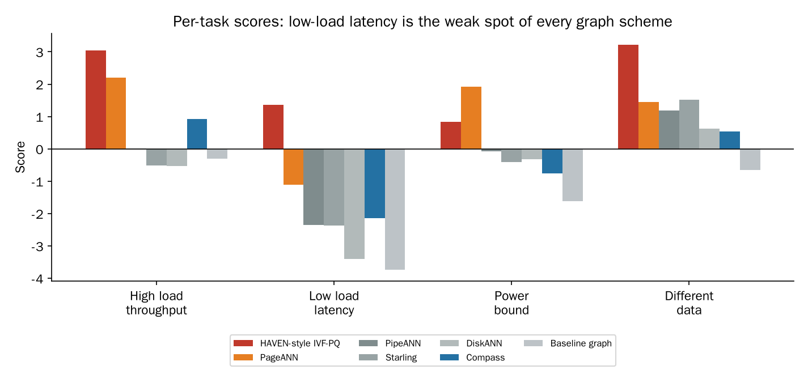
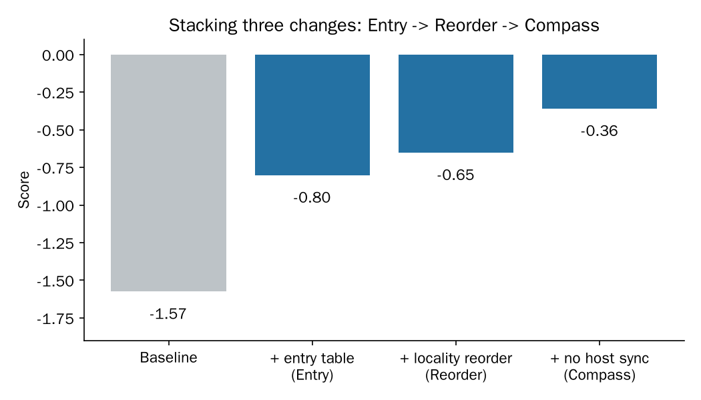
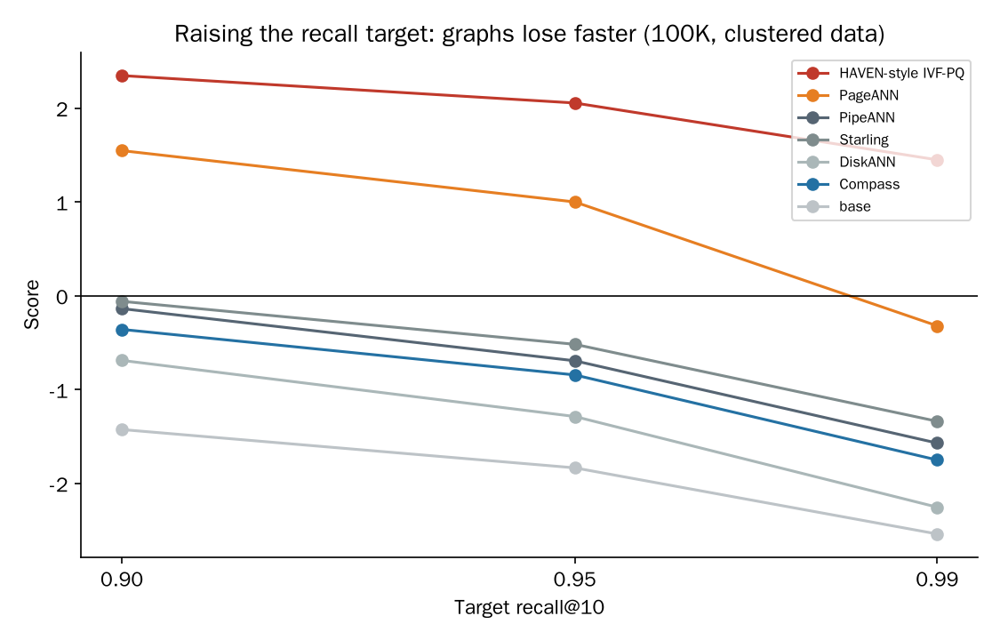
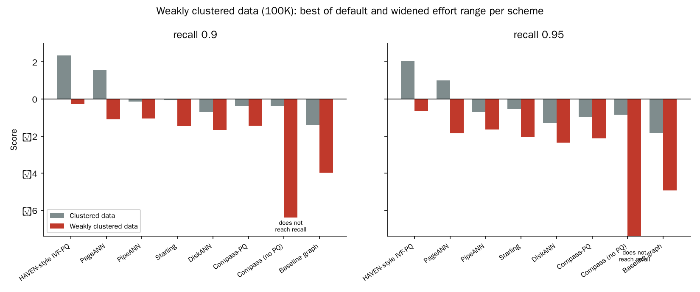
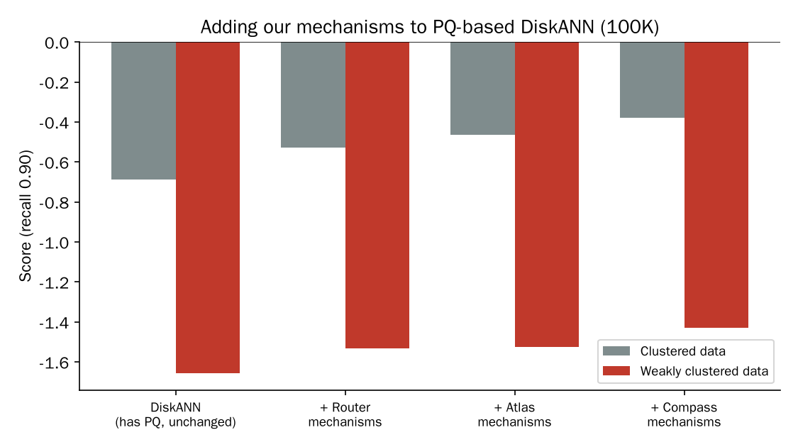

# Group meeting notes: evaluation system and first results for ANN search on HBF

> This week: (1) set up the environment, baselines and an evaluation system; (2) used it to compare the ANN algorithms that exist for SSDs, split into clustering-based and graph-based; (3) tried several optimizations on the graph side.
> **Say this up front:** all datasets are synthetic (same dimension and metric as SIFT / DEEP; real datasets could not be downloaded in our environment), and the compute-cost constants are estimates from RTX 4060 measurements and public specs. So the numbers are for comparing direction and relative size, not absolute values.

---

## 1. Environment, baselines, and why we cannot use HBFSim

### 1.1 Why we built our own evaluator
- HBFSim (arXiv 2609.09800) is the most complete HBF simulator, but it works by running a **real program on a real NVIDIA GPU** (in the paper: vLLM serving Qwen3-30B-A3B), **rewriting the GPU's PTX** so that accesses to HBF address ranges are routed to an HBF timing model (built on MQSim's flash model), and injecting the modeled latency back. The paper's testbed is an RTX PRO 6000 Blackwell.
- Three obstacles for us:
  1. It needs a real GPU in the loop and each experiment is a real run (600 to 86,400 s in the paper). We need to compare many candidate designs, so we need a model that scores one design in tens of seconds on a CPU.
  2. It targets LLM inference, whose access sequence is predictable (computing layer i takes about 130 µs, reading layer i+1's weights about 20 µs, so everything can be prefetched). Graph ANN is a **dependent chain**: which page to read next depends on the page just read. That is exactly the hard part on HBF, and their prefetching argument does not carry over.
  3. It has no ANN workload and none of the ANN-specific metrics (pages read per query, page-buffer hit rate, and so on).
- So we built our own validation system and **cross-checked it against MQSim** (the same flash model HBFSim builds on) **and the OCP spec**; see section 3.

### 1.2 Baselines (SSD ANN algorithms, ported to our HBF model)
| Family | Algorithm | Core idea | Source |
|---|---|---|---|
| Graph | DiskANN | Vamana graph; PQ codes in memory for coarse ranking; graph and full vectors on disk; synchronous beam search | NeurIPS'19 |
| Graph | PipeANN | Break strict best-first order so I/O and compute pipeline; latency down to 35% of DiskANN | OSDI'25 |
| Graph | Starling | Block shuffling: put graph neighbors in the same SSD block to read fewer blocks; in-memory navigation graph | SIGMOD'24 |
| Page-level graph | PageANN | A page is a graph node, so one hop reads one page; vectors + PQ inside the page | arXiv 2509.25487 |
| Clustering | HAVEN-style IVF-PQ | IVF clusters + PQ coarse filter + full-precision rerank; the rerank reads are independent and can all be issued at once | arXiv 2603.01175 |

- There is also a **Baseline graph**: a textbook graph search (neighbor graph, read every neighbor's full record to get its exact distance, expand one node at a time, fixed entry node, pages in ID order, no HBM use). All our optimizations start from it.
- HAVEN was designed for HBF. The others were designed for SSDs; porting keeps the algorithm and swaps the device parameters for HBF.

---

## 2. How the evaluator is designed

### 2.1 In one sentence
Each scheme runs 4 tasks on the HBF device model. A task's score is **log2(scheme throughput at recall@10 = 0.90 / throughput of a batched brute-force scan on the same device)**. The final score is the mean over the 4 tasks.

- 0 = as fast as brute force; +1 = twice as fast; -1 = half as fast.
- Why brute force is the zero point: it needs no index and any scheme can fall back to it, so it is the natural "must not be worse" reference. The log makes "twice as fast" worth the same at every scale.
- Why recall is fixed at 0.90 instead of mixing recall and throughput into one weighted sum: a weighted sum lets a scheme gain score by turning a knob toward whichever side the weights favor. Fixing recall and comparing throughput is cleaner. Higher recall targets are examined separately (section 6.3).
- A scheme that cannot reach 0.90 gets the floor, -8 (256x slower). Slower than brute force gives a continuous negative score; there is no upper cap.

### 2.2 What the four tasks measure
| Task | What it tests | Data | Load | Hardware tier |
|---|---|---|---|---|
| high_load | Throughput when parallel units are saturated | SIFT-like (128-d uint8, L2) | 0.75 clients per parallel unit | rotated by seed |
| low_load_4 | Latency with only 4 clients: every hop waits for one read | SIFT-like | 4 clients | rotated by seed |
| power_bound | Power budget becomes the bottleneck before bandwidth | SIFT-like | 0.75 clients per parallel unit | tier C |
| data_deep | Does it still work on a different data distribution | DEEP-like (96-d float32, L2) | 0.5 clients per parallel unit | rotated by seed |

How each number is computed:
- Scale: 100K vectors; at least 64 queries per task and at least 2 queries per client (so the run reaches steady state). Ground truth is exact brute-force search; the metric is recall@10.
- **Closed-loop load:** each client issues a query, waits for it to return, then issues the next. High-load throughput = completed queries / total time. Low-load throughput = number of clients / mean latency, so that task compares latency.
- **How the curve is swept:** search effort (beam width / candidate pool size / number of probed clusters) goes up in 9 steps; the sweep stops once recall passes 0.90. Throughput at exactly 0.90 comes from log-interpolation between the two neighboring points.
- **Four HBF product tiers A-D:** tR 1.5-20 µs, 32-128 parallel units per channel, 24-192 GB/s. Tiers rotate with the random seed so a scheme cannot be tuned to one hardware point.
- **Firmware details are drawn at random as "weather":** buffer replacement policy, Base-die timer, in-flight limit, jitter. Schemes cannot see them and must be robust to all.
- Hardware ceiling per task: at 100K vectors, about 12x (low load) to 100x (high load) above brute force, i.e. +3.7 to +6.7 points. Scores are not capped.
- **Compute is charged too:** a fixed cost per GPU wake-up (1.2 µs, the grid-sync time measured on an RTX 4060), on-chip bytes at on-chip bandwidth, results back to the host at PCIe speed. A scheme cannot score by assuming free compute.

### 2.3 The device model (the core of the evaluator)
An event-level model built from the OCP HBF spec v0.7.0, run on every evaluation:
- Each host channel has an in-flight request limit (MOCS). A normal read waits for the Base-die timer; Batch Read is issued immediately.
- Each parallel unit (die x bank) has a strictly ordered read queue. **Each bank has 2 page buffers of 4 KiB**; a read that hits a buffer returns immediately (0.05 µs, Base-die SRAM access time). A full page goes from the core die over the core-die channel to the Base die, then the requested bytes (from 64 B) go over the channel link.
- Every page sense costs tR and adds "read-disturb refresh debt" to its plane. When the debt is full, a refresh write occupies the die for about 75-200 µs and blocks reads.
- Per-stack power budget (read energy per sense; over budget means queueing) and read retries.
- Two implementations (Python and C) that agree event by event and bit by bit; 141 known-answer tests (expected values worked out by hand) all pass.

**What each mechanism is based on**
| Mechanism in the model | Based on |
|---|---|
| Bank mapping, 2 page buffers, same-bank ordering, Batch Read, MOCS | OCP HBF spec v0.7.0: https://www.opencompute.org/documents/ocp-hbf-architecture-specification-v0-7-0-final-pdf |
| Plane-level parallelism, read-round amplification (random placement about 6x slower), non-preemptible 75 µs program | HBFlex, arXiv 2609.18675: https://arxiv.org/abs/2609.18675 |
| tR of 20 µs, 64 B read granularity, read-disturb and retention refresh, thermal finding (compute die hits its limit first) | HBFSim, arXiv 2609.09800: https://arxiv.org/abs/2609.09800 |
| A parameter set for HBF (read energy 2-4x HBM, write bandwidth, endurance) | Characterizing HBF for LLM Serving, arXiv 2609.39131: https://arxiv.org/abs/2609.39131 |
| Disk-resident graph ANN viewpoint: how much of each read is actually useful | Disk-Resident Graph ANN Search: An Experimental Evaluation, PVLDB'26, arXiv 2603.01779: https://arxiv.org/abs/2603.01779 |
| recall@k vs QPS curve as the ANN evaluation standard | ANN-Benchmarks, Aumuller et al., arXiv 1807.05614: https://arxiv.org/abs/1807.05614 |
| Independent flash simulator used for cross-checking | MQSim, Tavakkol et al., FAST'18: https://www.usenix.org/conference/fast18/presentation/tavakkol |

### 2.4 Hot spots and load balance: where they are in the score
Hot-spot access and unbalanced use of banks / channels are **not scored as separate terms, on purpose, but they are inside the throughput that is scored**, and we report them as diagnostics.
- **Why they are already in the score:** a batch of queries cannot finish faster than the busiest bank's busy time. So throughput relative to the hardware ceiling is approximately
  (minimum parallelism / senses per query) x (1 / rho) x (utilization of the busiest bank),
  where rho = load of the busiest bank / mean load. The three factors are: how much of each sense is useful, how balanced the banks are, and whether banks sit idle. Each is charged exactly by the throughput it really costs; no hand-picked weights. Channel balance shows up in the bandwidth term. Hot dies also show up through queueing, per-plane refresh debt, retries and the power cap.
- **Why we do not score them directly:** a scheme could add useless reads to idle banks to make balance and utilization look better while throughput actually drops. Scoring only throughput closes that loophole.
- **What we report next to the score** (per task): senses per query, buffer hit rate, useful-byte fraction per sense, rho for banks and channels, utilization of the busiest unit, core-die channel imbalance, time spent waiting for power, and the shares of compute and wake-up cost in total time. These explain *why* a score moved.

- Reading the figure (high-load task): PageANN needs only about 33 page senses per query and HAVEN about 73, while our graph schemes need about 550-750 and DiskANN-style ports about 240. That is the dependency-chain / read-count gap in one picture. Compass has the highest hit rate among graph schemes (0.27) and keeps its busiest unit about half busy, but 62% of its time goes to GPU wake-up overhead; the other graph schemes spend 73-83% in compute. So after the flash-side fixes, the remaining bottleneck of our schemes is the host/compute side, not bank conflicts.
- The per-scheme bank imbalance rho was not saved in the graph study runs. For one of our schemes in an earlier run it was 1.1-1.3 across tasks, i.e. the busiest bank carried only 10-30% more than average, so bank imbalance was not the limiting factor there.
- Not scored yet (planned in the full design, not in the 4-task version used here): a tail-latency task (p99) and a skewed-query task (queries concentrated on a few hot regions, Zipf), which would test hot-spot banks more directly.

---

## 3. How we know the evaluator is right

There is no real HBF hardware, so we cross-check from several independent angles:

| Check | What we did | Result |
|---|---|---|
| Known-answer tests | Work out each device mechanism's timing by hand, compare with model output | 141 / 141 pass |
| HBF phenomena | 25 behaviors derivable from the spec and papers (per-tier bandwidth ceilings, power binding first, bank-conflict birthday effect, 2 buffers only keep a page re-read at distance 1, HBFlex plane parallelism and program blocking, ...) | all 25 hold |
| SSD direction check | Switch parameters to an NVMe SSD; the ordering of published methods must match their papers (PipeANN latency below DiskANN; PageANN and Starling read less than DiskANN; ...) | 5 of 6 hold; the CAGRA one fails because the graph is disconnected on synthetic data (cause identified) |
| Discrimination and cheating | Deliberately worsened / improved variants must move in the right direction across 4 tasks x 4 seeds; cheating schemes that answer without reading data or read one page only | worsened: 16/16 cells low; improved: 14-16/16 high; cheaters get recall about 0 and the floor score on all four tasks |
| Scale representativeness | 24 schemes at 100K and at 1M vectors, 3 seeds each, compare rankings | Spearman 0.894 (threshold 0.7): the 100K ranking represents 1M |
| **Independent simulator** | The same 22 schemes executed on MQSim configured as HBF (64 B read granularity); compare rankings | Spearman in the figure below. Nearly all disagreement comes from page buffers, which MQSim does not model; with buffer hits turned off in our model the Spearman with MQSim is 0.999 |
| Parameter sensitivity | Change each uncertain parameter once (tR, bandwidths, power, read disturb, buffer count, ...) and see whether the ranking changes | 22 perturbations, lowest rank correlation 0.93; no parameter reorders the ranking |

**What this does and does not establish (say it yourself before someone asks)**
- Core media timing: verified by an independent simulator.
- Page-buffer gains: based on OCP spec section 5.3.1; MQSim has no such mechanism, so they cannot be checked independently.
- Power, core-die channels, refresh: only our model has them; mis-estimating them does not change the ranking.
- Not covered: real HBF silicon; the exact compute-cost constants (placeholder estimates); the Base-die timer and retries barely matter for the current tasks.

---

## 4. Overall results (100K vectors, recall 0.90)

- **Clustering (HAVEN-style IVF-PQ) scores +2.11 and the page-level graph (PageANN) +1.11: both beat brute force.** All the other SSD graph algorithms ported to HBF are slower than brute force (-0.30 to -0.91). This matches our initial concern: graph algorithms designed for SSDs conflict badly with HBF.
- Our schemes (blue) lift the baseline graph from -1.57 to -0.36 (about 2.3x throughput): better than Starling and DiskANN, on par with PipeANN, **but still behind PageANN and HAVEN**.

- Low-load latency (4 clients) is the weak spot of every graph scheme: each hop on the dependency chain waits one tR (-2.1 to -3.4). HAVEN scores +1.36 here because its rerank reads are independent.

---

## 5. Clustering-based (HAVEN-style IVF-PQ), discussed separately

- **How it works:** at build time, cluster the vectors into 1024 clusters and compress each vector with PQ. At query time, use the PQ codes on chip to find the nearest clusters and pick rerank candidates; then **read all candidates' full vectors in parallel in one shot**, compute exact distances, and keep the best k.
- **Why it is strong on HBF:** it has no dependency chain. A graph hop needs the previous read to finish before it knows where to read next; IVF knows every rerank read right after the coarse filter, so all of them can be issued at once and fill HBF's parallelism and bandwidth. That is also why it leads most in the low-load task.
- **Its precondition (expect a question here):** the data must have cluster structure. Our synthetic data is generated from clusters, which favors IVF. With weakly clustered data (section 6.4) its score drops from +2.35 to -0.27, but it still ranks above every graph scheme we tested.
- We did not modify the clustering algorithm this week; it is HBF-native reference.

---

## 6. Graph-based: our optimization attempts

### 6.1 Starting point
The core conflict of SSD graph algorithms on HBF: **a read serves only one useful neighbor, and the next hop waits for the previous one** (dependency chain). Starting from the Baseline graph we tried mechanisms that shorten the chain, cut the number of reads, and exploit the page buffers. Each row gives what we did and where the idea comes from.

| Attempt | What we did | Targets | Idea from |
|---|---|---|---|
| (a) On-chip entry table / centroid routing | Put a set of sampled vectors (or k-means centroids and their nearest nodes) in HBM; a query compares against it on chip, then reads the few nearest entries at once as its initial candidates, instead of a fixed entry node | Shorter start of the chain; several independent starting reads issued in parallel and spread over different units | CAGRA (random sampled entries, arXiv 2308.15136); Starling (in-memory navigation structure); SPANN (centroid routing, arXiv 2111.08566) |
| (b) Locality reorder | k-means, then random-projection sort inside each cluster; renumber the nodes in that order and rewrite the adjacency; keep an original-ID map in HBM | Graph neighbors share a 4 KiB page, so one read (or one buffer hit) serves several neighbors | Starling block shuffling (arXiv 2401.02116); PageANN page alignment (arXiv 2509.25487) |
| (c) No host sync | Remove GPU-host synchronizing checks in the search loop (`any()`, max slot); use a static bound from the protocol instead | Fewer slow host round trips per wake-up, and wake-ups sit on the critical path | CAGRA's fixed-shape single-kernel batched search (arXiv 2308.15136) |
| (d) Beam search | Expand the W best candidates at once instead of one | Fewer serial rounds; reads spread over more parallel units | DiskANN beam search; PipeANN |
| (e) Wake-up batching | Wake the GPU only after several reads complete or a short timeout | Per-wake fixed cost amortized over more queries | HBFSim's "separate issue from use" idea; FLINT's burst-buffer coalescing (arXiv 2608.25062, abstract only) |
| (f) HBM adjacency cache | Keep the adjacency lists of the highest in-degree nodes in HBM (biased toward the entry region) so expanding them needs no flash read | First hops skip the flash round trip | DiskANN's C-hop cache; GoVector (arXiv 2508.15694) |
| (g) Add PQ to a graph (section 6.5) | Keep PQ codes in HBM for coarse ranking, read the full record only for expanded nodes | Fewer full-record reads | DiskANN; PageANN; HAVEN |

### 6.2 The seven best schemes, named
| Name | Score | What it combines |
|---|---|---|
| **Compass** | -0.36 | (a) entry table + (b) locality reorder + (c) no host sync |
| **Atlas** | -0.42 | (b) cluster-ordered layout + (a) centroid entry |
| **Router** | -0.48 | (d) beam of 2 + (a) query-routed entry |
| **Reorder** | -0.65 | (a) entry table + (b) locality reorder |
| **Entry** | -0.80 | (a) entry table only |
| **Batch** | -0.90 | (b) cluster-ordered layout + (e) wake-up batching |
| **Cache** | -1.00 | (f) HBM adjacency cache (biased to entry) |
| Baseline graph | -1.58 | none |

- **The stacking result is the cleanest:** the entry table alone takes -1.57 to -0.80; adding locality reorder gives -0.65; removing host syncs gives -0.36. All three contribute, and the entry table contributes most (it shortens the chain).
- Page-buffer hit rate: locality reorder raises it from about 0.16 to about 0.36 (reads concentrate on fewer pages).
- Router has a low hit rate (0.18); its gain comes from fewer hops, so it barely drops on the independent simulator (-0.48 to -0.49): the most robust to whether page buffers are real. Batch has the highest hit rate (0.39) and drops the most on the independent simulator (-0.90 to -1.84).

### 6.3 Raising the recall target: 0.90, 0.95, 0.99

- Every scheme's score falls as the recall target rises, and **graphs fall faster than clustering**: HAVEN 2.35 -> 1.45; PageANN 1.55 -> -0.32; Compass -0.36 -> -1.75.
- The ranking is mostly unchanged; Compass beats DiskANN at 0.90 and 0.95.
- Intuition: a higher recall target needs a larger candidate pool, so a graph keeps adding hops and reads along the dependency chain, while the clustering rerank reads are parallel and reading more candidates costs much less.
- Caveat on the method: each scheme has only 9 effort steps, so recall jumps between steps; throughput at 0.90 / 0.95 / 0.99 is interpolated between two steps.

### 6.4 Weakly clustered data

How: data generated from 1024 overlapping components with a smaller spread, so that a 64-cluster k-means explains only 24% (SIFT-like) / 40% (DEEP-like) of the variance, down from 64% / 74%. Relative contrast drops from 2.12 to 1.42 (SIFT-like). **This data is harder overall, not only "less clusterable".**

- Every scheme gets two tries: the default search-effort range and a widened one (all effort upper limits opened to their maximum); the figure shows the better of the two. At recall 0.90 on weakly clustered data:
  - **HAVEN-style IVF-PQ: -0.27** (it was +2.35 on clustered data). It still ranks first, and it is the only scheme within reach of brute force.
  - PageANN -1.10, PipeANN -1.04, Starling -1.46, DiskANN -1.66, Compass-PQ -1.43. The PQ-based graphs all lose about 1 to 1.4 log2 units compared with clustered data (throughput down to about 1/2 to 1/2.6).
  - **Graph schemes without PQ fail on this data:** the Baseline graph scores -3.96 and Compass (no PQ) cannot reach recall 0.90 at all (full effort reaches about 0.91 for the baseline and far less for Compass), so it is at the floor. Reading every neighbor's full record gets very expensive when distances are less informative, and their search limits (hop cap, list sizes) run out first. This one is a property of the algorithms, not of the parameter range.
- So switching to weakly clustered data does **not** rescue the graph side: clustering still wins at recall 0.90, and the gap between it and the best graph shrinks from about 2.5 to about 0.8 log2 units (about 6x to about 1.7x in throughput).
- Recall 0.95: HAVEN -0.63, PipeANN -1.65, PageANN -1.84, Starling -2.06, DiskANN -2.35.

### 6.5 Adding PQ to the graph schemes

DiskANN already has PQ, so we did not treat PQ as the missing piece. Instead we **carried the mechanisms of Compass / Atlas / Router onto DiskANN's PQ search** (entry table, cluster-ordered layout, no host sync) to see whether their gains survive. The variants are called Compass-PQ, Atlas-PQ and Router-PQ.

- All three variants beat DiskANN on both datasets (clustered -0.69 -> -0.38; weakly clustered -1.66 -> -1.43), so these mechanisms still work inside a PQ-based search.
- The gain is modest (0.2-0.3 log2 units, about 15-25% throughput) and **does not exceed the PQ-less Compass** (-0.38 vs -0.36). Adding PQ to our scheme is not a shortcut to close the gap to PageANN / HAVEN.
- The gap to PageANN / HAVEN comes mainly from whether the dependency chain is flattened, not from having compressed vectors: DiskANN already has PQ and still scores -0.91, while HAVEN's rerank reads are independent and much faster.

---

## 7. Findings for discussion
1. SSD graph algorithms ported to HBF are all slower than brute force under this evaluator. HBF's high parallelism with slow random reads is in structural conflict with the dependency chain of graph search.
2. Mechanisms aimed at the chain (on-chip entry table, locality reorder, no host sync) together raise the textbook graph search to about 2.3x throughput, reaching PipeANN level, but a clear gap remains to methods that flatten the chain (HAVEN's cluster + parallel rerank, PageANN's one-page hop).
3. The higher the recall target, the more graphs lose; the gap is largest in the low-load latency task. Making the data weakly clustered narrows the gap to clustering (about 2.5 to about 0.8 log2 units at recall 0.90) but does not close it; graphs without PQ fail on that data.
4. The evaluator itself has been cross-checked from several angles (independent-simulator Spearman 0.89-0.94, 0.999 with page-buffer hits off; 22 parameter perturbations leave the ranking unchanged) and is reliable for comparing schemes. Page-buffer gains have no independent source and are the largest remaining uncertainty.

**Questions to put to the group**
- Are graph methods worth continuing on HBF? Their advantages (weakly clustered data, very high recall targets, incremental updates) need to be shown to hold on HBF.
- Is page-level graph (PageANN) plus our entry / no-sync mechanisms a more promising combination?
- The real behavior of the page buffers (access time on hit, replacement policy) needs hardware / vendor data.

## 8. Limitations and what is not finished
- **Data is synthetic** (SIFT-like / DEEP-like); needs to be re-checked on real data.
- **The 1M-vector comparison against PageANN and HAVEN is not finished**; the direct results are at 100K (the 100K-vs-1M ranking agreement is Spearman 0.894).
- The widened-range rerun on weakly clustered data is still running for some of our schemes (Atlas, Batch, Cache, Atlas-PQ, Router-PQ and others); the figure shows only schemes that have finished.
- Compute-cost constants are placeholders; real HBF silicon is not covered.
- The 4-task version has no tail-latency (p99) task and no skewed-query (hot-spot) task yet; balance and hot spots enter only through throughput (section 2.4).
- The recall 0.95 / 0.99 numbers are interpolated between 9 effort steps.

---

## Appendix: references
- OCP *HBF High-Level Base Die Specification* v0.7.0: https://www.opencompute.org/documents/ocp-hbf-architecture-specification-v0-7-0-final-pdf
- HBFSim: https://arxiv.org/abs/2609.09800 (code: https://github.com/SlugLab/hbfsim/ )
- HBFlex: https://arxiv.org/abs/2609.18675
- Characterizing HBF for LLM Serving: https://arxiv.org/abs/2609.39131
- HAVEN: https://arxiv.org/abs/2603.01175
- DiskANN (NeurIPS'19): https://papers.nips.cc/paper/2019/hash/09853c7fb1d3f8ee67a61b6bf4a7f8e6-Abstract.html
- PipeANN (OSDI'25): https://www.usenix.org/conference/osdi25/presentation/guo
- Starling (SIGMOD'24): https://arxiv.org/abs/2401.02116
- PageANN: https://arxiv.org/abs/2509.25487
- Disk-resident graph ANN evaluation (PVLDB'26): https://arxiv.org/abs/2603.01779
- CAGRA: https://arxiv.org/abs/2308.15136
- SPANN: https://arxiv.org/abs/2111.08566
- GoVector: https://arxiv.org/abs/2508.15694
- FLINT: https://arxiv.org/abs/2608.25062 (abstract only)
- ANN-Benchmarks: https://arxiv.org/abs/1807.05614
- MQSim (FAST'18): https://www.usenix.org/conference/fast18/presentation/tavakkol
